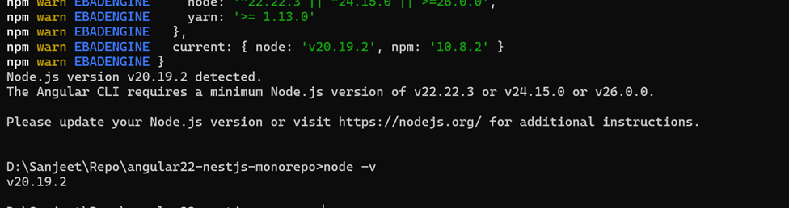
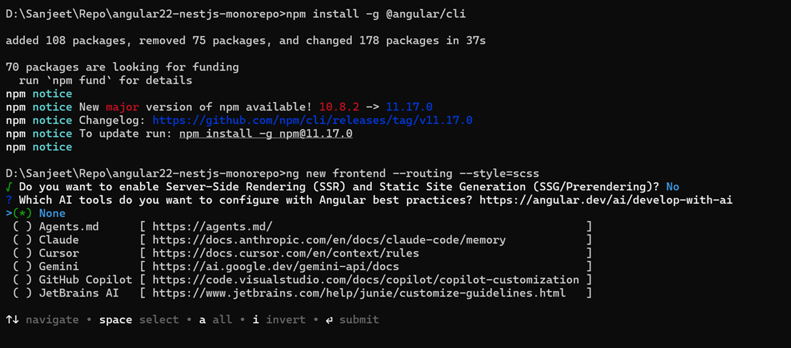
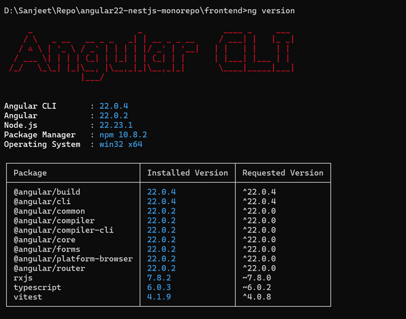
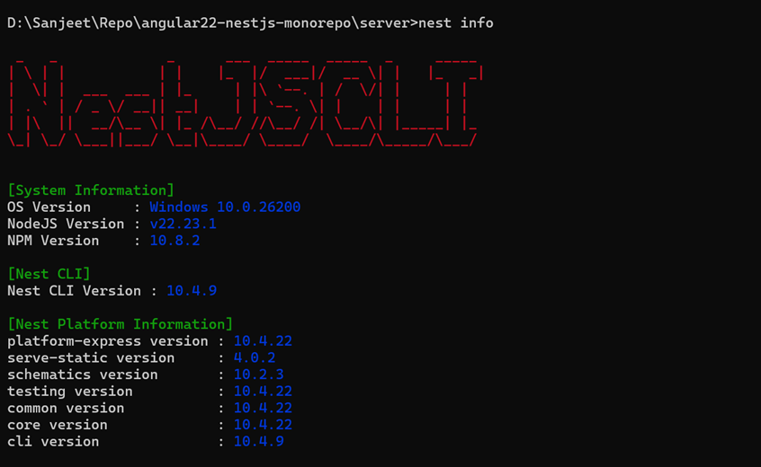

## angular MCP server
angular 22 on node 22+, Angular 22 was officially released on June 3, 2026
```
https://blog.angular.dev/announcing-angular-v22-c52bb83a4664
```



AI tutor: https://angular.dev/ai/ai-tutor

Develop with AI: https://angular.dev/ai/develop-with-ai

angular starts on http://localhost:4200/

nestjs starts on http://localhost:3000/
## on render
```
monorepo-app/
│
├── .github/
│   │
│   ├── DISCUSSION_TEMPLATE/ (optional)
│   ├── labels.yml
│   ├── stale.yml
│   ├── renovate.json (instead of Dependabot if preferred)
│   ├── ISSUE_TEMPLATE/
│   │   ├── bug_report.md
│   │   ├── feature_request.md
│   │   └── question.md
│   │   └── config.yml
│   │
│   ├── workflows/
│   │   ├── ci.yml
│   │   ├── deploy.yml
│   │   └── release.yml
│   │   ├── codeql.yml
│   │   └──dependabot-auto-merge.yml
│   │
│   ├── pull_request_template.md
│   ├── CODEOWNERS
│   ├── dependabot.yml
│   ├── FUNDING.yml
│   ├── SECURITY.md
│   ├── SUPPORT.md
│   ├── CODE_OF_CONDUCT.md
│   
│
├── frontend/        (Angular 22)
│   ├── src
│   ├── angular.json
│   └── package.json
│
├── server/          (NestJS)
│   ├── src
│   ├── nest-cli.json
│   └── package.json
│
├── package.json     (root workspace)
└── render.yaml      (optional)
└── CONTRIBUTING.md
└── README.md
└── LICENSE
```

## deployment flow
```
Angular build
    ↓
frontend/dist/browser
    ↓
copy to
server/public
    ↓
NestJS serves static files
    ↓
Render Web Service
```
## Create Angular first
```
npx @angular/cli@22 new frontend
```
needs node v22 +

Verify:
```
ng version
```



## Create NestJS
```
nest new server
```
## Serve Angular from NestJS
```
npm install @nestjs/serve-static@4.0.2
```
run to Verify
```
nest info

npm list @nestjs/core

npm list @nestjs/common
```



another structure
```
sanjeet-portfolio/
├── frontend/     Angular 22
├── server/       NestJS 11
├── shared/       DTOs/types
└── render.yaml
```
Features:

* Angular 22 standalone components
* NestJS REST APIs
* PostgreSQL on Render (optional)
* JWT authentication
* Contact form API
* Docker-ready later if needed

This can be deployed on Render's free/low-cost plan as a single Web Service without any issues.

## AWS fundamentals
https://awsfundamentals.com/


[CURE](https://github.com/sanjeetkumaritoutlook/angular22-nestjs-monorepo/releases/download/v1.0.0-cure/972504900-All-Zones-Detailed-Maps.pdf)

https://boardgamegeek.com/boardgame/365742/bacon


## source-code hosting platforms
github

gitlab

bitbucket

azure devops

Human-in-the-loop (HITL)

https://roadmap.sh/
## MAI-Code-1.1-Flash

https://github.blog/changelog/2026-06-02-mai-code-1-flash-is-now-available-for-github-copilot/

https://github.com/microsoft/MAI-Code

https://microsoft.ai/

## angular 17 ai logic box

```
 iMocha's patented pseudo-coding platform. It evaluates an Angular 17 developer's core architectural and programming logic rather than strict syntax accuracy.
• How it works: It acts as a "code in the blanks" window where candidate answers are auto-evaluated using partial scoring based on real-world scenarios

https://www.imocha.io/tests/angular-17-skills-test

https://www.imocha.io/platform/ai-logicbox
```


## pep8 style guide
```
PEP 8 is the official Python Enhancement Proposal that serves as the definitive style guide for writing clean, readable, and consistent Python code.
```
https://medium.com/@roanmonteiro/the-complete-guide-to-anthropics-claude-certifications-the-4-exams-the-prerequisite-that-blocks-4d1f743bc5c4


https://medium.com/@ravianandjec/understanding-copilot-customization-instructions-agents-and-skills-01cf715a930d

https://github.com/mehmetozkaya/genai-for-dotnet/blob/main/README.md#-course-update-migrating-away-from-github-models

https://github.com/mehmetozkaya/genai-for-dotnet

https://workspaceupdates.googleblog.com/2026/10/preview-edit-and-collaborate-on-Markdown-files-natively-across-Drive-and-Docs.html

Markdown has become the common language between humans and AI agents - specs, plans, READMEs, tables, task lists, generated docs - so much of this starts as .md.

Now you can keep the file as Markdown and still use your favorite Docs collaboration workflows. :)
## build ai agents end to end in vs code
https://techcommunity.microsoft.com/blog/azuredevcommunityblog/build-ai-agents-end-to-end-in-vs-code/4418117
