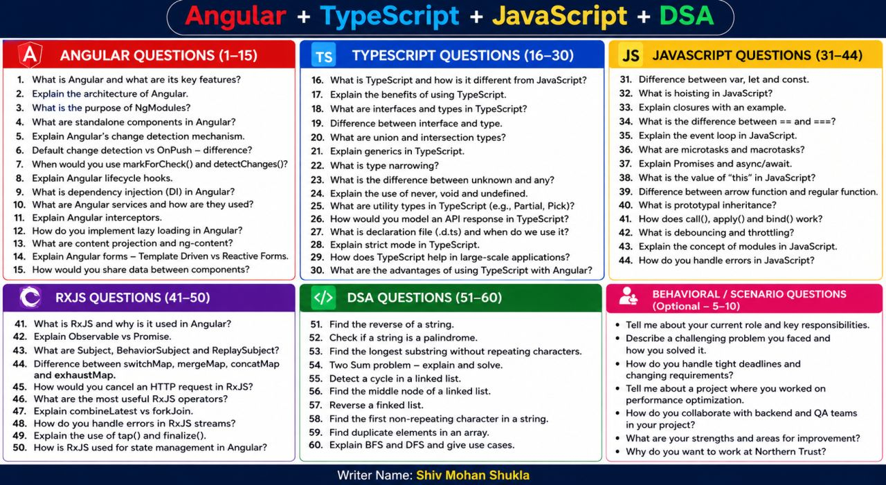
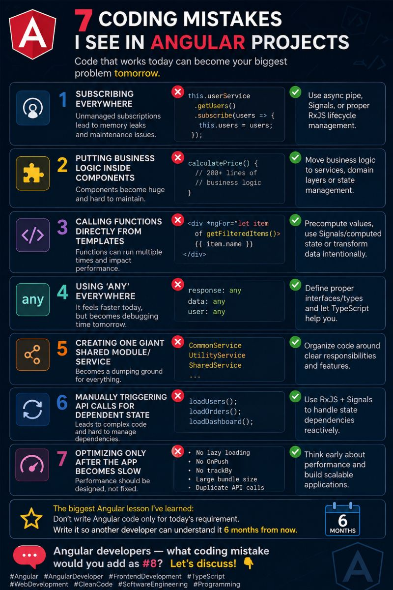

🚀 Angular + TypeScript + JavaScript + DSA — Interview Preparation Guide

Preparing for a 5+ years Full Stack Developer / Angular Developer interview? This cheat sheet covers some of the most important areas you should revise:
```
🔹 Angular – Architecture, DI, Change Detection, Lifecycle Hooks, Interceptors, Forms, Lazy Loading
🔹 TypeScript – Interfaces, Generics, Union Types, Utility Types, "unknown" vs "any", Strict Mode
🔹 JavaScript – Hoisting, Closures, Event Loop, Promises, "this", Call/Apply/Bind, Debouncing & Throttling
🔹 RxJS – Observables, Subjects, "switchMap", "mergeMap", "forkJoin", Error Handling, State Management
🔹 DSA – Strings, Arrays, Linked Lists, Two Sum, BFS & DFS
🔹 Behavioral Questions – Real-world scenarios, challenges, performance optimization & teamwork
```


