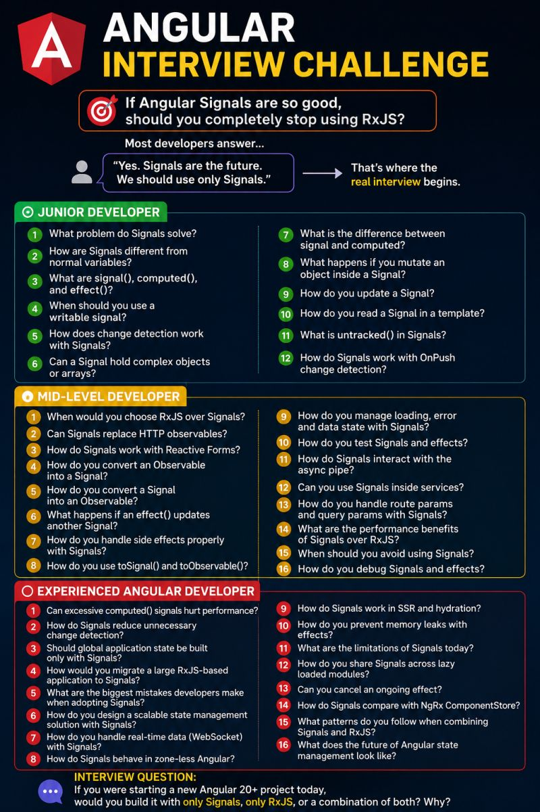

🚀 Angular Interview Challenge

Almost every Angular developer says...

"Yes, I've used Signals."

Then I ask this.

If Angular Signals are so good, why hasn't Angular removed RxJS?

The room usually goes silent.

Let's see how far you can go.

## 🟢 Junior Developer

✅ What problem do Signals solve?

✅ How are Signals different from normal variables?

✅ What are `signal()`, `computed()`, and `effect()`?

✅ When would you use a Signal instead of a component property?

##  🟡 Mid-Level Developer

✅ When would you choose Signals over Observables?

✅ Can Signals replace HTTP calls?

✅ How do Signals work with Reactive Forms?

✅ How do you convert an Observable into a Signal?

✅ When can using `effect()` create unexpected bugs?

##  🟠 Senior Developer

You're building an enterprise billing application.

Thousands of products.

Real-time stock updates.

Multiple API calls.

Complex Reactive Forms.

Which state would you manage with Signals, which with RxJS, and why?

Can an application built entirely with Signals scale as well as one that combines Signals and RxJS correctly?

