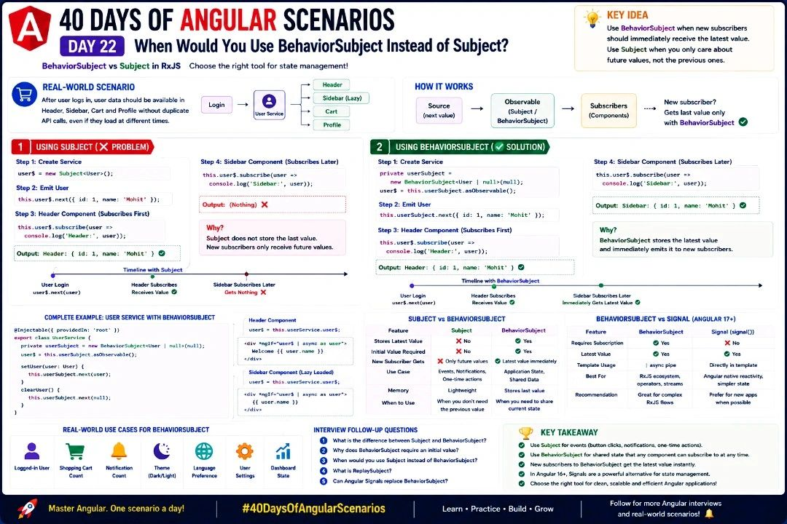

🚀 Angular Developers, are you using Subject when you should be using BehaviorSubject?

It's one of the most common RxJS interview questions—and a concept every Angular developer should understand.

🎯 Day 22 Interview Scenario:
A user logs in, and their profile needs to be displayed in the Header, Sidebar, Cart, and Profile components. Some components load later than others.

How do you ensure every component immediately receives the latest user data without making another API call?

✅ Answer: Use BehaviorSubject.
```
Here's the difference:
🔹 Subject → Emits only future values. New subscribers won't receive previously emitted data.
🔹 BehaviorSubject → Stores the latest value and immediately emits it to every new subscriber.
```
💡 Key Takeaway: 
```
Use BehaviorSubject for shared application state like logged-in users, shopping cart count, theme, or user preferences. Use Subject for one-time events such as button clicks, notifications, or event broadcasting. If you're building with Angular 17+, also explore Signals as a modern alternative for state management.
```
