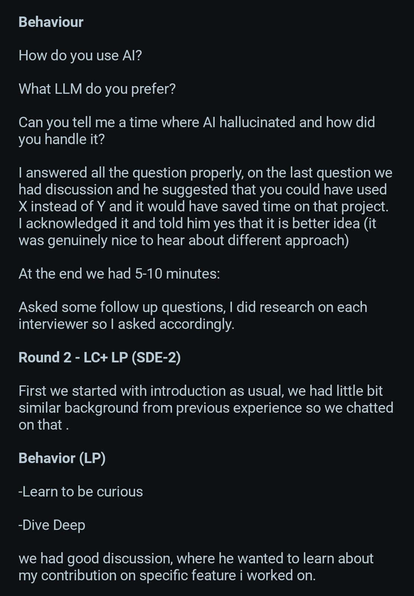
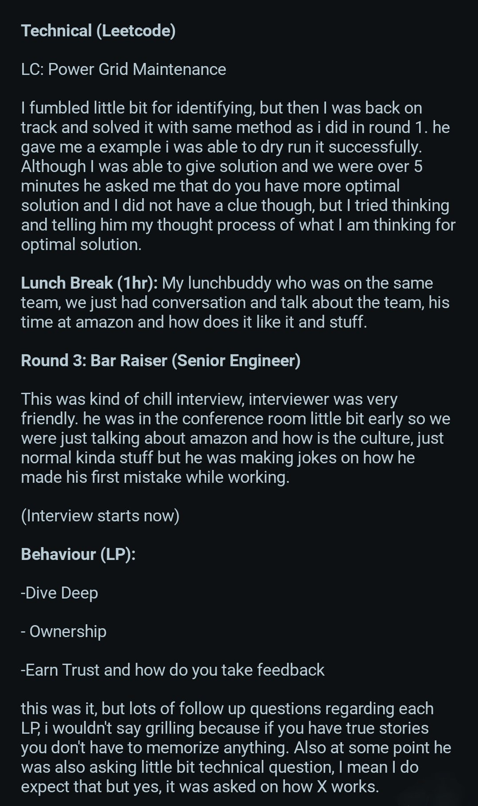
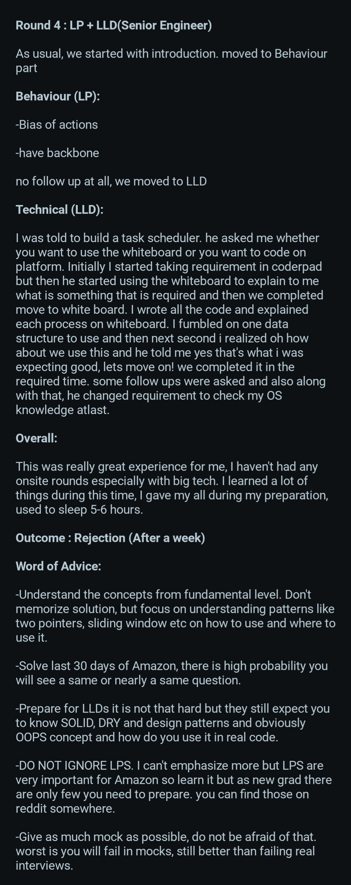

Amazon SDE Internship Interview Experience which pays around 1.4 lakh per month 

## Round 1: Online Assessment (OA)

- 2 DSA coding problems
- 9 sections of behavioral questions based on Amazon Leadership Principles
- Tip: Practice DSA consistently and prepare behavioral answers using STAR.

## Round 2: Technical Interview

DSA 1: Minimum Window Substring

- Find the smallest substring containing all characters of another string, including frequencies.
- Example: ""timetopractice"", ""toc"" → ""toprac""
- Approach: Sliding window + frequency map.

DSA 2: Rearrange Characters with Minimum Distance

- Rearrange lowercase characters so identical characters are at least "k" positions apart, inserting placeholders if needed, and find the minimum sequence length.
- Example 1: "['a','b','a','a','a','b']", "k = 3" → "13"
- Example 2: "['a','b','a','a','c','d']", "k = 4" → "11"
- Approach: Frequency counting + greedy placement.

## Round 3: Technical Interview

Project Discussion: Poultry Disease Detection (Deep Learning + Image Classification)
Approximately 20 minutes covering:

- Project architecture and model selection.
- Why ResNet50? Transfer learning and its implementation.
- Development challenges, model evaluation and finalization.
- AI tools used, why they were chosen, incorrect suggestions encountered, and how AI-generated outputs were verified.
- A difficult situation and how it was handled.

## Two DSA Problems:

1. 4Sum: Find four array elements whose sum equals a target. Example: "[4,7,12,1,6,5,2]", target "16" → "[7,1,6,2]". Approach: Sorting + two pointers or hashing.
2. Maximum Candies per Child: Distribute candies among "k" children, with each child receiving candies from a single pile; piles can be split but not merged. Maximize candies per child. Approach: Binary search on the answer.

